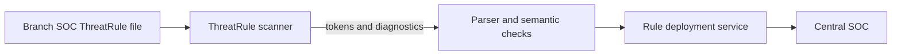
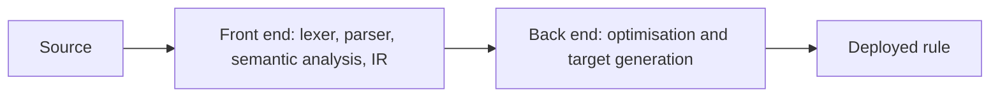

# CSA1409 Assignment 1: ThreatRule Compiler Front End

## 1. Language processors

A **preprocessor** expands includes and macros before compilation. A **compiler** translates the ThreatRule source into a target representation. An **assembler** translates assembly into object code, while a **linker** joins object files and libraries. A **loader** places the executable in memory. An **interpreter** executes source or an intermediate form directly. This project needs a compiler front end because every branch SOC should apply the same repeatable validation rules before a detection rule is accepted.

## 2. Phases of a compiler

For `RULE ssh_attack IF attempts > 5 THEN ALERT "SSH brute force";`, lexical analysis produces tokens such as `RULE`, `IDENTIFIER(ssh_attack)`, `IF`, `IDENTIFIER(attempts)`, `RELATIONAL_OP(>)`, `INTEGER(5)`, `THEN`, `ALERT`, and `STRING`.

The parser would form an abstract syntax tree whose root is `Rule`, with a rule name, condition, and alert action. Semantic analysis checks that the condition is boolean, that `attempts` is a known numeric field, and that the alert text is present. A possible three-address form is `t1 = attempts > 5; if t1 goto alert_ssh_attack`. Optimisation removes unreachable or repeated conditions. Target generation serialises the validated rule to the SOC rule-engine format. A symbol table stores identifiers and their properties; the error handler records the line and recovery action, then continues scanning.

## 3. Grouping of phases

The front end is shared by branch SOCs so the meaning of a rule does not vary by location. One compiler pass reads the source and produces tokens; a later pass can parse and validate the complete rule. This two-pass organisation keeps the scanner small while allowing independent syntax and policy changes.

## 4. Compiler construction tools

The project uses a lexical-analyser generator (Flex), a parser generator (suitable future choice: Bison), syntax-directed translation routines, code-generator tools, data-flow/optimisation tools, and compiler-construction toolkits. Flex is preferred to a hand-written scanner because its regular expressions are concise, reviewable, and generate an efficient deterministic scanner.

## 5. Role of the lexical analyser

The lexical analyser reads characters, groups them into lexemes, and emits tokens for the parser. For example, the token is `IPV4_ADDRESS`, its pattern is four decimal components separated by dots, and the lexeme is `10.0.0.5`. Flex buffers input so it reads blocks rather than one operating-system call per character. It also separates character-level concerns from parser grammar.

Recovery examples: `999.10.1.1` is matched as an IPv4-shaped lexeme but rejected because an octet exceeds 255; `@` is reported as an unsupported character and skipped; an unfinished quote is reported as an unterminated string at the end of the line. The scanner then continues with later input.

## 6. Token specification

| Class | Regular definition | Example |
| --- | --- | --- |
| Identifier | `[A-Za-z_][A-Za-z0-9_]*` | `ssh_attack` |
| Integer | `[0-9]+` | `443` |
| IPv4 candidate | `[0-9]{1,3}(\\.[0-9]{1,3}){3}` plus range check | `10.0.0.5` |
| SHA-256 | `[A-Fa-f0-9]{64}` | 64 hexadecimal characters |
| CVE | `CVE-[0-9]{4}-[0-9]{4,7}` | `CVE-2026-12345` |
| URL | `https?://...` | `https://security.example.org/a` |
| String | quoted characters with escapes | `"SSH brute force"` |

Keywords are recognized before the identifier rule, so `RULE` cannot be accidentally installed as an identifier. The scanner supports union through alternatives, concatenation through adjacent pattern components, and repetition through `*`, `+`, and bounded repetitions.

## 7. Token recognition

An identifier DFA starts in a non-accepting state, accepts a letter or underscore, and stays accepting while letters, digits, or underscores arrive. It uses one-character lookahead: a delimiter is not part of the identifier, so Flex leaves it for the next rule. IPv4 recognition has four digit-component states separated by dots; the action validates the numeric ranges after recognition. For `src_ip`, the trace is start → `s` → `r` → `c` → `_` → `i` → `p` → accept. For `>=`, the scanner reads `>` then looks ahead to `=` and accepts the two-character relational operator.

## 8. LEX specification

`src/threatrule.l` contains three standard LEX sections: C declarations and helper functions, regular-expression rules with actions, and the `main` driver. `yytext` contains the matched lexeme, `yylineno` supplies line numbers, and `yyin` is the input stream. Running Flex produces `lex.yy.c`, which GCC compiles into the scanner executable. Identifiers are installed only once in the symbol table.

## 9. Implementation and testing

Run `scripts/run_tests.ps1` to generate the scanner and exercise three fixed input sets: valid baseline rules, invalid/recovery rules, and new live-feed token rules. It additionally generates deterministic files containing 100, 1,000, 10,000, and 100,000 rules. A valid input must exit with status zero; an invalid input must exit non-zero after reporting all detected lexical errors.

## 10. Performance evaluation

The test runner measures elapsed wall-clock milliseconds for each generated file and prints a table. Record the machine and run date alongside the results because absolute timings depend on the computer. Throughput should be calculated as `tokens scanned / seconds`; the linear Flex DFA design should scale approximately with input size. Error count is zero for generated files by construction.

## 11. Final design recommendation

Use the Flex-generated scanner with case-insensitive keyword matching, a small identifier table, validation actions for IPv4 values, and fail-soft line-based recovery. This combination is suitable for many branch submissions because regular token recognition is linear in the input length and errors do not prevent diagnostics for later rules. A full deployment should add a Bison parser, field-type metadata, rule-size limits, audit logging, and policy validation.

## 12. Day-4 live-feed challenge

### 12A. Impact analysis

SHA-256 hashes, CVE identifiers, and URLs introduce overlapping lexical shapes: a hash resembles an identifier-plus-digits sequence, CVE has fixed hyphenated structure, and URLs include punctuation such as `:` and `/`. Continuous error reporting remains important because one bad feed value should not discard later indicators.

### 12B. Original-design evaluation

Before the extension, those values would be divided into identifiers, integers, punctuation, and unsupported characters, producing incorrect tokens and errors. The supplied `live_feed_rules.tr` is the regression test that proves the extended scanner recognizes each new class as one token.

### 12C. Adaptation decision

Modify the existing scanner. Add the `HASH`, `CVE`, and `URL` definitions before the general identifier and punctuation rules. This preserves the scanner architecture while giving the more specific patterns priority.

### 12D. Evidence-based defence

The modification is small, deterministic, and covered by a separate live-feed test file. The trade-off is that the URL pattern deliberately accepts a broad safe character set; production systems should apply stricter semantic URL validation after tokenization. Keeping lexical and semantic validation separate avoids an overly complex scanner.
